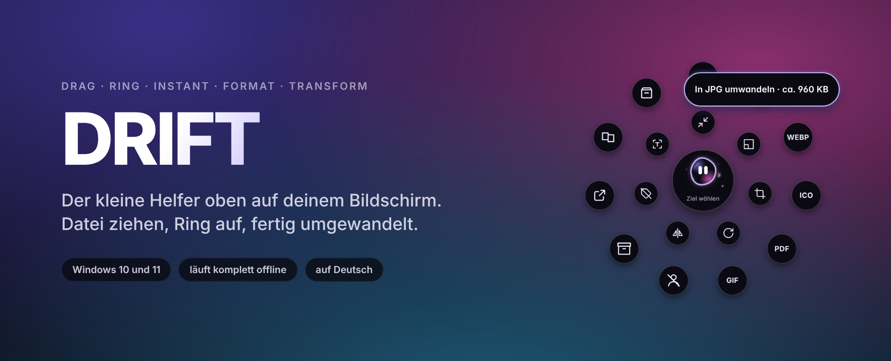
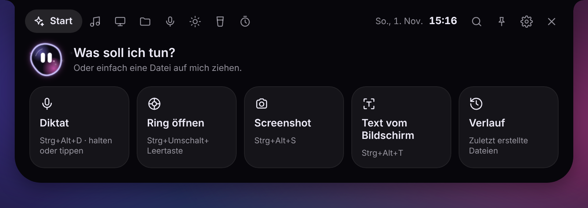
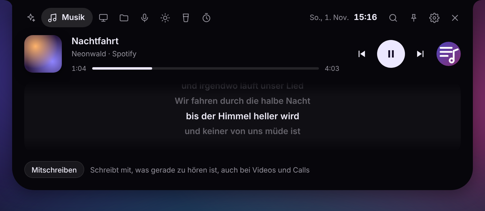
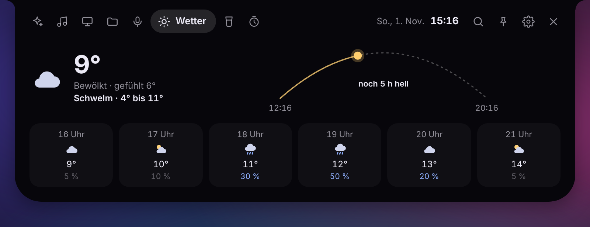
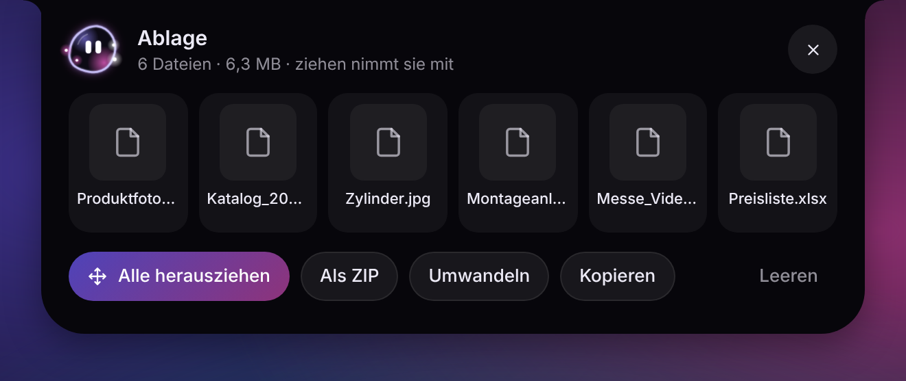
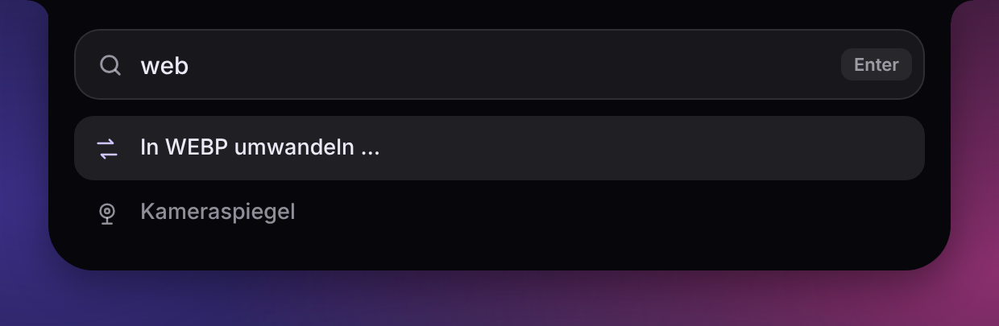
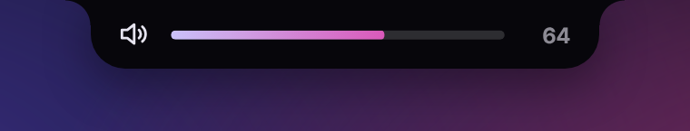

  

  
  
  

  <a href="https://github.com/nils1989sch-byte/drift/releases/latest"><b>Download DRIFT for Windows</b></a>
  &nbsp;·&nbsp;
  <a href="https://ko-fi.com/slinsch">Support DRIFT</a>
  &nbsp;·&nbsp;
  <a href="README.md">Deutsch</a>

---

DRIFT lives as a small black island at the top of your screen. Grab a file in Explorer, press Shift while dragging, and a ring opens right at your cursor. Drop the file on the format you want and the new file appears next to the original. The original is never touched.

On top of that there are screenshots, dictation, a shelf for files, music with synced lyrics and a few small things that make the workday nicer. Conversions run on your own computer, no upload, no account.

> DRIFT itself is in German right now. An English interface is in the works, and the screenshots below will follow.

## The ring

  

The ring only shows what fits the file. For an image that means other image formats, PDF, background removal, crop, rotate, flip and more; for a video MP4, GIF, audio only or 720p. Hover a dot and it turns into a pill with its name and the estimated size afterwards. Several files at once work too.

| Type | Formats and tools |
| --- | --- |
| Images | PNG, JPG, WEBP, AVIF, TIFF, GIF, ICO, PDF · remove background, crop, resize, compress, rotate, flip, grayscale, strip metadata, text recognition, combine |
| PDFs | PNG, JPG, WEBP, TXT · merge, split into pages, rotate, text recognition |
| Videos | MP4, WEBM, GIF, MP3, WAV, still frame · compress, 720p, remove audio, rotate, flip |
| Audio | MP3, WAV, M4A, FLAC, OGG · compress, normalize loudness, mono |
| Archives | pack as ZIP, unpack ZIP, 7Z, RAR, TAR, GZ and more |

Steps you use a lot can become a recipe, for example "remove background, white background, square, 2000 px, JPG" for shop images. The recipe then shows up in the ring.

## The island

  

Click the island to open its menu. Along the top are the sections: start, music, screen, files, voice, weather, water reminder and timer.

  

If you like, the island sits right at the top edge of the screen as a notch, like on a MacBook. You can also drag it to any other edge or corner.

<table>
  <tr>
    <td width="50%"></td>
    <td width="50%"></td>
  </tr>
  <tr>
    <td>Music from Spotify, the browser or any other player, with lyrics that scroll along. "Mitschreiben" turns videos, podcasts and calls into a live transcript.</td>
    <td>Weather with a sun arc and the next six hours. Hover the island and it shows a short version too.</td>
  </tr>
</table>

## Shelf

  

Park files from different folders for a moment. Put them in via "Ablegen" in the ring, or give the mouse a quick shake while dragging and the shelf opens by itself. From there you drag everything into an email or a folder at once, pack it as a ZIP or convert it in one go.

## Search instead of clicking

  

Ctrl + Alt + F opens a search across everything DRIFT can do. Type a few letters like "webp", "timer" or "note", then Enter.

## What else is in there

- Screenshots across all monitors. Drag an area, click a window or take the whole screen. The image lands in the clipboard right away and can be dragged straight into an email, edited or cut out.
- Screen recording as MP4, optionally as GIF afterwards.
- Text from the screen: draw a frame around text and it lands in the clipboard.
- Dictation into any window. Speech recognition (whisper.cpp) runs on your own computer.
- Merge PDFs: drop PDFs on the island one after another, sort them, done.
- Downloads at a glance: when a download finishes, the island offers to unpack or convert it.
- Volume shown in the island, and a small dot while an app uses the microphone or camera.
- Camera mirror for a quick check before a call.
- Quick notes, timer, water reminder and history.
- Power saving mode for slower computers, which can switch on by itself.

  

## Installation

1. Download `DRIFT-Setup-….exe` from [Releases](https://github.com/nils1989sch-byte/drift/releases/latest).
2. Double-click it. Windows may show the blue SmartScreen notice because the installer isn't signed by a big company. Click "More info" and then "Run anyway".
3. DRIFT starts and explains itself in a few short steps the first time.

DRIFT downloads new versions in the background and installs them the next time you quit.

## Keyboard shortcuts

| Shortcut | What happens |
| --- | --- |
| Drag a file + Shift | Ring at the cursor |
| Ctrl + Shift + Space | Open the ring |
| Ctrl + Alt + Space | Island menu |
| Ctrl + Alt + F | Search |
| Ctrl + Alt + S | Screenshot |
| Ctrl + Alt + R | Screen recording |
| Ctrl + Alt + T | Text from the screen |
| Ctrl + Alt + D | Dictation (hold or tap) |
| Ctrl + Alt + N | Quick note |
| Ctrl + Alt + H | Island to front or back |
| Hold Ctrl + Alt | Shows all shortcuts |

All shortcuts can be changed in the settings.

## Privacy

Your files never leave your computer. Converting, text recognition, dictation and transcripts all run locally. DRIFT only goes online for these things:

- checking for updates here on GitHub,
- the weather from Open-Meteo, if you entered a location,
- lyrics from LRCLIB, if you turn them on,
- the speech model for dictation, downloaded once the first time you use it.

## Requirements

Windows 10 or 11, 64-bit. On slower computers DRIFT can switch to a power saving mode with less animation.

## Support DRIFT

DRIFT is free and stays free. If it saves you time, a coffee is very welcome. The first goal is a code signing certificate so Windows stops warning during installation, after that it pays for time spent on new features.

  

## Found a bug or have an idea?

Under [Issues](https://github.com/nils1989sch-byte/drift/issues/new/choose) there is a template for bugs and one for ideas. English is fine.

---

DRIFT is a private project by nils1989sch-byte. The source code is not public; finished versions are available here under Releases. © 2026, all rights reserved.
