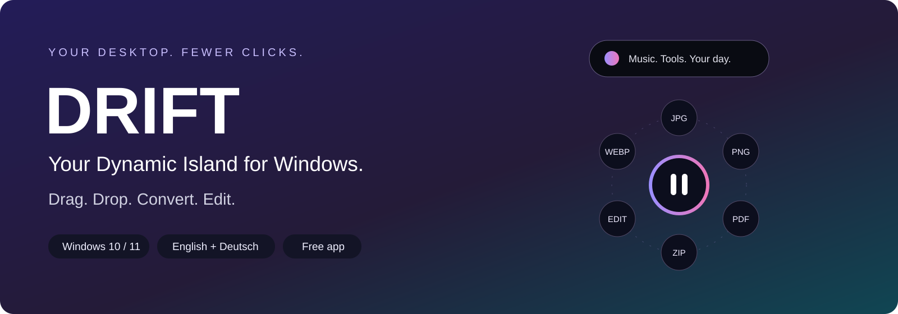
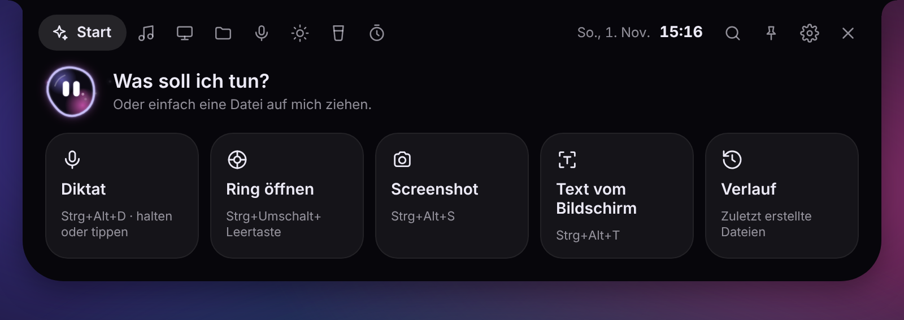
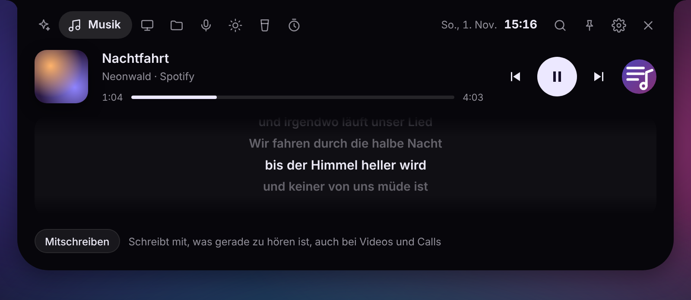
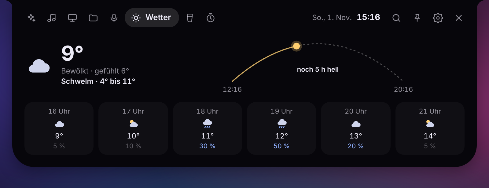
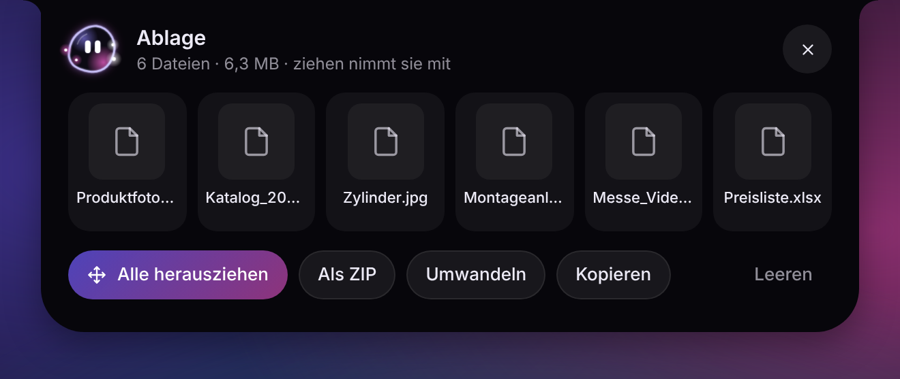
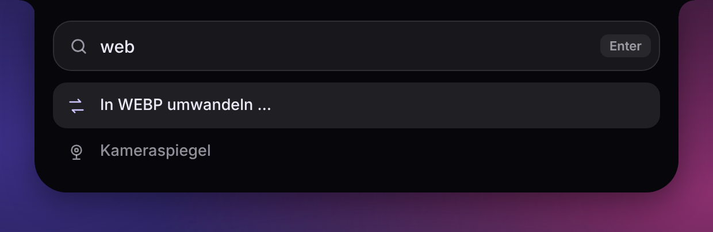

  

  
  
  

  <a href="https://github.com/nils1989sch-byte/drift/releases/latest"><b>DRIFT für Windows herunterladen</b></a>
  &nbsp;·&nbsp;
  <a href="https://ko-fi.com/slinsch">DRIFT unterstützen</a>
  &nbsp;·&nbsp;
  <a href="README.en.md">English</a>

---

# Deine Dynamic Island für Windows

Eine Insel, wie du sie von Apple kennst — für deinen Windows-Desktop. DRIFT verbindet eine Oberfläche im Stil der Dynamic Island für Musik, Schnellzugriffe und Alltagsaufgaben mit **Dateien umwandeln und bearbeiten per Drag-and-drop**. Datei ziehen, Umschalt halten, Aktion im Ring wählen — fertig.

**Jetzt auf Deutsch und Englisch · Windows 10 & 11 · Dateiverarbeitung lokal · Ohne Konto**

- **Bilder fertig machen:** umwandeln, verkleinern oder freistellen — auch mehrere auf einmal.
- **PDFs zusammenbringen:** auf die Insel ziehen, Reihenfolge festlegen und zusammenfügen.
- **Dateien gesammelt weitergeben:** aus verschiedenen Ordnern in der Ablage parken und gemeinsam in eine Mail ziehen.

Zieh eine Datei aus dem Explorer, halte dabei Umschalt und lass sie auf das gewünschte Format im Ring fallen. Die neue Datei liegt neben dem Original; das Original bleibt unverändert.

## Der Ring

  

## Hilf mit, DRIFT weiterzuentwickeln

Ich bin Nils, der Entwickler hinter DRIFT. Ich möchte alltägliche Dateiaufgaben unter Windows mit weniger Klicks erledigen. **DRIFT ist kostenlos und bleibt es — Unterstützung ist freiwillig.**

Wenn dir DRIFT Zeit spart, kannst du die Entwicklung auf Ko-fi unterstützen. Das erste Ziel ist die Codesignierung für Installationsdateien mit überprüfbarem Herausgeber. Weitere Unterstützung hilft bei der Pflege, Verbesserungen und neuen Funktionen.

[**DRIFT auf Ko-fi unterstützen →**](https://ko-fi.com/slinsch)

Ein einmaliges Dankeschön ist willkommen; monatliche Unterstützung ist optional. Auch Weiterempfehlen, ein GitHub-Stern oder ein Fehlerbericht helfen dem Projekt.

### Formate und Werkzeuge

Der Ring zeigt nur, was zur Datei passt. Bei einem Bild sind das andere Bildformate, PDF, Freistellen, Zuschneiden, Drehen, Spiegeln und Co., bei einem Video MP4, GIF, nur den Ton oder 720p. Fährst du über einen Punkt, wird er zur Pille mit Namen und der geschätzten Größe danach. Mehrere Dateien auf einmal gehen auch.

| Was | Formate und Werkzeuge |
| --- | --- |
| Bilder | PNG, JPG, WEBP, AVIF, TIFF, GIF, ICO, PDF · Freistellen, Zuschneiden, Verkleinern, Komprimieren, Drehen, Spiegeln, Schwarzweiß, Metadaten weg, Text erkennen, Verschmelzen |
| PDFs | PNG, JPG, WEBP, TXT · zusammenfügen, in Seiten trennen, drehen, Text erkennen |
| Videos | MP4, WEBM, GIF, MP3, WAV, Standbild · komprimieren, 720p, ohne Ton, drehen, spiegeln |
| Audio | MP3, WAV, M4A, FLAC, OGG · komprimieren, Lautheit angleichen, Mono |
| Archive | ZIP packen, ZIP, 7Z, RAR, TAR, GZ und mehr entpacken |

Was du öfter brauchst, legst du als Rezept an, zum Beispiel „Freistellen, weißer Hintergrund, quadratisch, 2000 px, JPG“ für Shop-Bilder. Das Rezept steht danach mit im Ring.

## Die Insel

  

Ein Klick auf die Insel öffnet das Menü. Oben liegen die Bereiche als Symbole: Start, Musik, Bildschirm, Dateien, Sprache, Wetter, Trinken und Timer.

  

Auf Wunsch sitzt die Insel als Notch direkt an der oberen Bildschirmkante, wie beim MacBook. Du kannst sie auch an jede andere Kante oder in eine Ecke ziehen.

<table>
  <tr>
    <td width="50%"></td>
    <td width="50%"></td>
  </tr>
  <tr>
    <td>Musik aus Spotify, dem Browser oder jedem anderen Player, mit Songtext, der mitläuft. „Mitschreiben“ macht aus Videos, Podcasts und Calls ein Live-Transkript.</td>
    <td>Wetter mit Sonnenbogen und den nächsten sechs Stunden. Fährt die Maus über die Insel, zeigt sie es kurz auch im Kleinen.</td>
  </tr>
</table>

## Ablage

  

Dateien aus verschiedenen Ordnern kurz parken. Du legst sie über „Ablegen“ im Ring hinein, oder du schüttelst beim Ziehen kurz die Maus, dann klappt die Ablage von selbst auf. Von dort ziehst du alles zusammen in eine Mail oder einen Ordner, packst es als ZIP oder wandelst es gesammelt um.

## Suchen statt Klicken

  

Strg + Alt + F öffnet eine Suche über alles, was DRIFT kann. Ein paar Buchstaben wie „webp“, „timer“ oder „notiz“, dann Enter.

## Was sonst noch drin ist

- Screenshot über alle Bildschirme. Bereich aufziehen, ein Fenster anklicken oder den ganzen Bildschirm nehmen. Das Bild liegt sofort in der Zwischenablage und lässt sich direkt in eine Mail ziehen, bearbeiten oder freistellen.
- Bildschirmaufnahme als MP4, auf Wunsch danach als GIF.
- Text vom Bildschirm: Rahmen um einen Text ziehen, der Text liegt in der Zwischenablage.
- Diktat in jedes Fenster. Die Spracherkennung (whisper.cpp) läuft auf dem eigenen Rechner.
- PDFs zusammenfügen: PDFs nacheinander auf die Insel ziehen, Reihenfolge sortieren, fertig.
- Downloads im Blick: Ist ein Download fertig, bietet die Insel gleich Entpacken oder Umwandeln an.
- Lautstärke in der Insel und ein kleiner Punkt, solange ein Programm Mikrofon oder Kamera nutzt.
- Kameraspiegel, um vor einem Call kurz nachzusehen.
- Schnelle Notizen, Timer, Trinkerinnerung und Verlauf.
- Sparmodus für schwächere Rechner, der sich auf Wunsch von selbst einschaltet.

  

## Installation

1. Unter [Releases](https://github.com/nils1989sch-byte/drift/releases/latest) die Datei `DRIFT-Setup-….exe` herunterladen.
2. Doppelklicken. Windows zeigt möglicherweise einen SmartScreen-Hinweis. Prüfe, dass der Installer aus dem offiziellen Release dieses Repositorys stammt, bevor du entscheidest, ihn auszuführen.
3. DRIFT startet und erklärt sich beim ersten Mal in ein paar kurzen Schritten.

Neue Versionen lädt DRIFT selbst im Hintergrund und installiert sie beim nächsten Beenden.

## Tastenkürzel

| Kürzel | Was passiert |
| --- | --- |
| Datei ziehen + Umschalt | Ring am Mauszeiger |
| Strg + Umschalt + Leertaste | Ring öffnen |
| Strg + Alt + Leertaste | Menü der Insel |
| Strg + Alt + F | Suchen |
| Strg + Alt + S | Screenshot |
| Strg + Alt + R | Bildschirmaufnahme |
| Strg + Alt + T | Text vom Bildschirm |
| Strg + Alt + D | Diktat (halten oder antippen) |
| Strg + Alt + N | Schnelle Notiz |
| Strg + Alt + H | Insel in den Vorder- oder Hintergrund |
| Strg + Alt gedrückt halten | zeigt alle Kürzel |

Alle Kürzel lassen sich in den Einstellungen ändern.

## Datenschutz

Deine Dateien verlassen den Rechner nicht. Umwandeln, Texterkennung, Diktat und Mitschreiben laufen lokal. Ins Internet geht DRIFT nur für diese Dinge:

- die Suche nach Updates hier auf GitHub,
- das Wetter von Open-Meteo, wenn du einen Ort eingetragen hast,
- Songtexte von LRCLIB, wenn du sie einschaltest,
- einmalig das Sprachmodell für das Diktat, wenn du es zum ersten Mal benutzt.

## Systemvoraussetzungen

Windows 10 oder 11 mit 64 Bit. Auf schwächeren Rechnern schaltet DRIFT auf Wunsch in einen Sparmodus mit weniger Animation.

## Fehler gefunden oder eine Idee?

Unter [Issues](https://github.com/nils1989sch-byte/drift/issues/new/choose) gibt es je eine Vorlage für Fehler und für Vorschläge.

---

DRIFT ist ein privates Projekt von nils1989sch-byte. Der Quellcode ist nicht öffentlich, die fertigen Versionen gibt es hier unter Releases. © 2026, alle Rechte vorbehalten.
